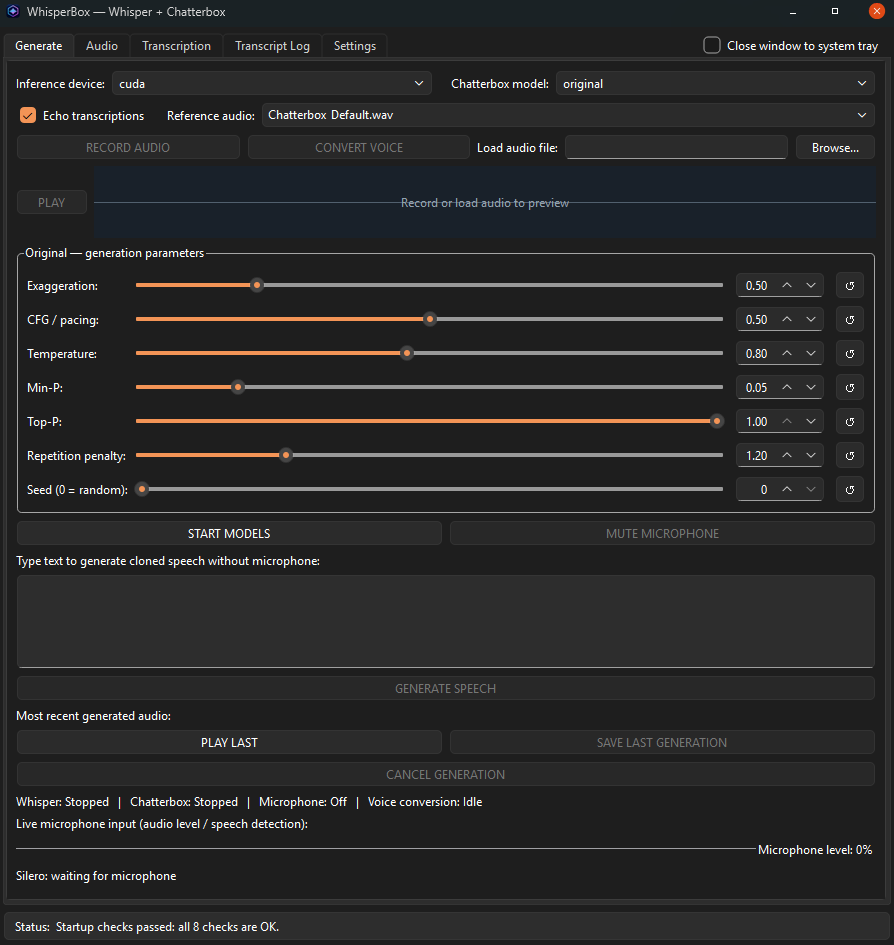

# WHISPERBOX

WhisperBox is a Windows desktop application that combines speech recognition, text-to-speech, voice cloning, and voice conversion in a single interface. It uses Faster-Whisper, Silero VAD, and Resemble AI's Chatterbox to transcribe speech, generate natural-sounding voices, and convert existing recordings to different voices. WhisperBox supports real-time microphone transcription, long-form speech generation, streaming playback, and audio processing. All speech processing runs locally, with support for CPU and NVIDIA GPU acceleration.

  

Compatibility: Windows 10 (64-bit, version 1809+) and Windows 11. Windows 10 compatibility has not been fully tested.

## QUICK INSTALL (INTERNET REQUIRED)
1. Extract the entire ZIP to a writable folder.
2. Run Install_WhisperBox.bat and choose the environment method:
   [1] Automatic private Python (recommended). Downloads Python 3.10 and 3.11
       into runtime/ without requiring system Python or Conda.
   [2] Existing Conda environments.
   [3] Existing Python / venv (requires 64-bit Python 3.10 and 3.11).
   Dependencies are installed through uv.
3. Choose CPU or NVIDIA CUDA. Installation then begins automatically.
   CUDA requires a compatible NVIDIA GPU and installed NVIDIA driver.
4. Installation provisions packages, downloads model weights, checks imports
   and GPU compute (if chosen), and prepares Chatterbox_Default.wav.
5. Double-click Launch_WhisperBox.vbs to start WhisperBox.
   If launching fails, inspect logs\gui_startup.log.

## IMPORTANT
- The ZIP contains the application, not Python environments or large model
  weights. The first installation requires internet access and free disk space.
- Option 3 never downloads a Python interpreter. It searches installed Python
  versions (including pyenv-win), or prompts for full executable paths.
- Keep your installation folder in place after installing private environments.
- An update extracted over the same folder preserves runtime/, models/,
  config/, logs/, presets, and saved audio. Do not delete those directories.
- Installation logs: logs\install_transcript.log. To repair dependencies or
  an interrupted installation, rerun Install_WhisperBox.bat.
- Models run locally after initial setup, without online inference services.

## GENERATE TAB
- Select Chatterbox Original or Turbo, a reference voice, and a CPU/CUDA device.
  The reference voice dropdown refreshes its choices whenever you open it.
  Add your own WAV/MP3/OGG references to models\voices.
- START MODELS loads Whisper/Silero and, when Echo is enabled, Chatterbox.
- Microphone listening is AUTOMATIC: Silero detects speech, and Whisper
  transcribes it. MUTE MICROPHONE / UNMUTE MICROPHONE toggles listening.
  Echo transcriptions is independent of microphone capture. When enabled,
  Chatterbox speaks recognized text in the selected reference voice.
- GENERATE SPEECH speaks typed text without transcription.
- RECORD AUDIO / STOP RECORDING separately captures a source clip for voice
  conversion. That clip remains in memory; recording does not run Whisper or
  Echo. CONVERT VOICE transforms the source using the reference voice.
- BROWSE chooses an external audio source without discarding the last recording.
  Clicking the source field restores 'Using current recording...' when available.
- The conversion waveform supports Play/Pause and click-to-seek.
  Playback ending resets the playhead to the start. The preview
  audibly includes the enabled input audio effects.

## AUDIO AND SETTINGS
- The Audio tab offers input/output device selection and WASAPI loopback.
  Avoid using Echo with loopback capture of the same playback device.
- Conversion source recordings stay in RAM. The Chatterbox conversion backend
  temporarily stages its input under WhisperBox/data while processing, then
  deletes the staging file; no WhisperBox recording temp folder is created in
  Windows AppData.
- Settings include Whisper beam size (1–5), Cache Voice Conditioning, Chunked
  TTS (on by default), and Streaming Playback (on by default; available when
  Chunked TTS is enabled). Existing saved preferences are preserved.
- Long TTS requests are always split into safe model-sized segments, even when
  Chunked TTS is disabled. Playback is one combined WAV unless Streaming
  Playback is enabled. Text requests over 100,000 characters are rejected explicitly.
  Large outputs may take substantial time to finish when Streaming Playback is off.
- Saving and Storage controls where WAV recordings and transcripts are saved.
  Tools and Maintenance includes presets, startup checks, and diagnostics ZIPs.
- The Transcript Log displays recent recognized text.

## TROUBLESHOOTING
- Missing models: rerun Download_Models.bat while connected to the internet.
- Missing packages or Python: rerun Install_WhisperBox.bat (same method).
- CUDA failures: verify your driver or reinstall using CPU.
- Missing input/output devices: check Windows permissions and connections,
  then use Refresh Audio Devices on the Audio tab.
- Startup errors: logs\gui_startup.log. Export diagnostics from Settings if
  WhisperBox opens; diagnostic bundles exclude recorded audio and transcripts.
- Note: Windows GUI/microphone integration and third-party hardware have not
  been comprehensively certified. Stop Models and model switches may briefly
  pause the UI while workers shut down.

## THIRD-PARTY LICENSES
WhisperBox is built using the following open-source projects:

- **Chatterbox** — Resemble AI  
  https://github.com/resemble-ai/chatterbox

- **Faster-Whisper** — SYSTRAN  
  https://github.com/SYSTRAN/faster-whisper

- **Silero VAD** — Silero Team  
  https://github.com/snakers4/silero-vad

All three projects are licensed under the MIT License.
